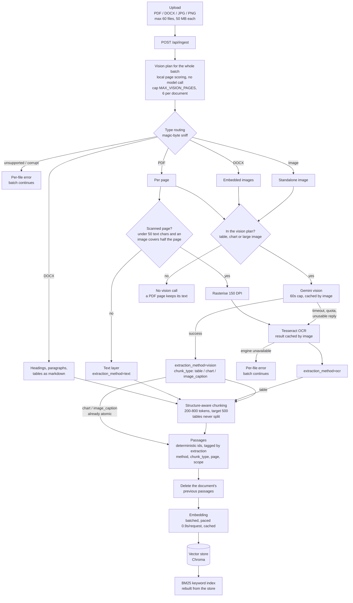
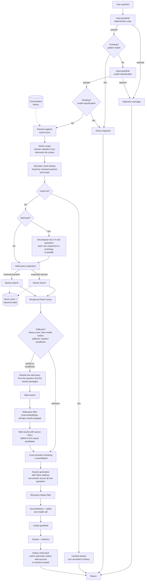
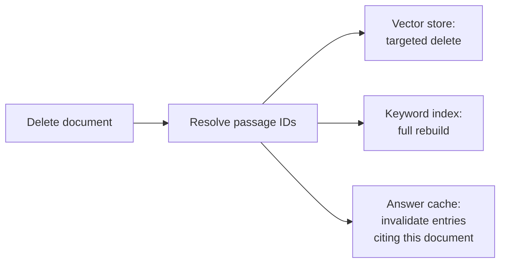

# 3. System Architecture

The system comprises two pipelines that share a single storage layer. The **ingestion pipeline** converts documents into indexed, searchable passages. The **query pipeline** converts a user question into a cited answer. The storage layer, a vector store and a keyword index over the same passages, is written by the first and read by the second. The passage schema that crosses this boundary is the formal interface between them.

---

## 3.1 Ingestion Pipeline



### Stage descriptions

**Type routing (INGEST-01).** Incoming files are classified by extension and verified against their magic bytes, since a collected corpus is likely to contain mislabelled files. Content-Type is deliberately not consulted: browsers derive it from the extension, so it is wrong in exactly the case the check exists to catch. Unsupported or unreadable files are skipped with a recorded per-file error and the remainder of the batch continues: a single malformed document must not abort ingestion of forty-nine valid ones. A file over the 50 MB limit is reported as too large rather than passed on as empty bytes, so the uploader is not told a document is corrupt when it is merely big.

**Text-layer extraction.** PDFs are processed page by page, preserving page numbers, which every corpus citation depends on. A DOCX file becomes one text piece in document order: each heading is written as a markdown heading, paragraphs sit under it, and each table is one markdown table block, so the chunker can cut at headings and keep tables whole. Table-cell text is not present in the document's paragraph collection and must be walked separately. Embedded DOCX images are extracted as well and treated like standalone images (D-18).

**Scanned-document detection (D-17).** A PDF page counts as scanned on two conditions together: fewer than 50 extractable characters, and a placed raster image covering at least half the page. Both are required because a genuinely sparse page (a section divider, a mostly blank form page) has little text but nothing to look at; its text stands as-is. A scanned page is rasterised at 150 DPI and goes straight to OCR. It is never a vision candidate: it has no text layer to enrich, OCR is local and free, and sending every scanned page to the model would spend the vision budget on plain transcription. The decision is made per page rather than per document, since documents mixing digital and scanned pages are common.

**Vision extraction (INGEST-02).** Selected page images, embedded DOCX images, and standalone images are submitted to a vision-language model with a prompt requesting structured output: tables transcribed as markdown preserving row and column relationships, and charts described by type, axes, and readable data points. An unstructured prose description is of little retrieval value; the structure is what makes a table's contents matchable against a question. The model classifies its own output, and that classification becomes the passage's `chunk_type` (`table`, `chart`, or `image_caption`). Charts and captions are already short and self-contained, so they bypass chunking and become one passage directly. A PDF page sent to vision keeps its text layer too, so the page yields a text passage and a vision passage; only a near-empty page is represented by the vision passage alone.

Two limits bound this stage. Each request is capped at 60 seconds with no SDK-internal retry: long enough for a real transcription, measured at roughly 15 to 30 seconds per figure, while still failing over to OCR rather than stalling a batch. Responses are cached by image content, so re-ingesting a document does not pay for its figures twice. A throttled key is a separate matter, handled by rotation rather than by the timeout: the API reports a rate limit immediately, and the request is retried against the next key in the pool with exponential backoff.

**Vision page selection and budget.** Which pages reach the model is decided for the whole batch before any model call, from local measurements only. Every PDF page is scored: a detected table of at least 4 by 3 cells, 300 or more vector drawings (a probable chart), or an image covering half the page each count as a strong signal, and a page needs at least one. Standalone images and embedded DOCX images are always candidates and outrank page guesses. The best candidates are kept within `MAX_VISION_PAGES` (80 for the batch), with at most 6 per document so that one long report cannot take the whole budget. A document the corpus manifest marks chart-dense that has no page scoring normally still gets its single best page if that page shows a weaker signal. A page that is not selected is not sent to OCR in its place: it simply keeps its text layer. When a plan exceeds the cap, the corpus ingestion script stops with an error so the thresholds can be tightened, while the upload endpoint keeps the best pages and reports the rest as dropped.

**OCR (D-17, D-27).** OCR produces the passage in two cases: the page is scanned, or vision extraction failed, timed out, or returned nothing usable. One engine does this work: Tesseract, run locally at roughly a second per page. It returns plain text in reading order and does not recover table structure, so a table on a scanned page reaches the index as flattened text rather than as rows and columns. That is accepted: figures and tables on digital pages go to the vision model, and OCR is left with the scanned pages and the occasional vision failure. A page is lost only when the Tesseract binary cannot be run, which is reported as a per-file error naming the configured path.

OCR output is cached on disk, keyed by the image, so a stopped or repeated ingestion run does not recognise the same page twice. In the current corpus OCR accounts for a small share of passages: the scanned PDFs and the handful of pages where the vision reply was unusable.

**Structure-aware chunking (INGEST-03).** Passages target 500 tokens and are bounded at 200 and 800 (`CHUNK_TARGET_TOKENS`, `CHUNK_MIN_TOKENS`, `CHUNK_MAX_TOKENS`), measured with a tiktoken `cl100k_base` length function. Splits fall on structural boundaries (headings, paragraph breaks, table blocks) in preference to fixed offsets. A run of two or more consecutive markdown table rows is detected as a table and emitted whole as a `chunk_type="table"` passage even when it exceeds the maximum: an oversized intact table is more useful than two fragments of one. The nearest preceding markdown heading is carried into each passage's `location` field, which materially improves retrieval on structured documents.

**Dual indexing (INGEST-04).** Passage identifiers are deterministic: a hash of the scope, document, extraction method, chunk type, page, location, position, and text. Re-ingesting an unchanged document therefore rewrites the same passages, and before a re-ingested document is indexed its previous passages are deleted, so an edited file does not leave its old version beside the new one. Passages are embedded in batches, and each batch is written to the vector store as soon as it succeeds, so a failure partway through a long document does not discard the passages already embedded. Embedding requests are paced, because the embedding API issues one request per text rather than a true batch call, which would otherwise breach the free-tier ceiling. The BM25 keyword index is then rebuilt once from the vector store. Deriving it from the store rather than writing both in parallel is what makes the two indexes share one identifier per passage by construction: the keyword index cannot drift from the store it is built from. One passage, two indexes, one identifier.

---

## 3.2 Query Pipeline



### Stage descriptions

**Input guardrails (QUERY-13).** Two tiers. Deterministic checks run first: length bounds, control-character stripping, and known injection patterns. A model-based classification runs only if the deterministic tier passes, so that no API call is spent rejecting an empty string. A rejected input ends the query there with a short reason and nothing is retrieved. The two tiers are interleaved with the two greeting tiers, deterministic steps first: rule guardrail, pattern greeting, model guardrail, model greeting.

**Greeting short-circuit (QUERY-01).** Short conversational inputs are answered directly without retrieval. The classifier is deliberately biased towards passing input through: incorrectly short-circuiting a genuine question is a far worse failure than unnecessarily retrieving for a greeting.

**Conversational resolution (QUERY-15).** A follow-up question is rewritten into a self-contained form against the last 2-3 turns before any downstream stage sees it. "Why did it decline?" becomes "Why did Acme's Q3 revenue decline?". This stage is placed early by necessity, because retrieval, expansion, decomposition, and caching are all incapable of handling an unresolved pronoun. Questions that are already self-contained pass through unmodified.

**Semantic cache (QUERY-02).** The resolved question is embedded and matched against previously answered questions by vector similarity, so a paraphrase of an earlier question returns its stored answer. The similarity threshold is set conservatively: because a cache hit bypasses the entire pipeline, an over-permissive threshold returns a confident answer to a question that was never actually asked, with no downstream stage able to catch it. Cache entries are keyed by document scope as well as question, and record which documents their answer cited. A hit is still recorded as a turn in the conversation history. The scope is chosen just before the lookup: a session that has uploaded documents is answered from those documents alone, and every other question from the corpus.

**Decomposition (QUERY-12).** Compound questions are split into 2-4 sub-questions. Each sub-question then runs expansion, retrieval, fusion, sufficiency assessment, web fallback, and reranking independently, and the sub-questions run in parallel. Detection is biased against decomposing, since an unnecessary decomposition multiplies retrieval cost and can produce a worse answer than a single well-targeted pass: a cheap pattern check must pass before the model is asked to split anything.

**Multi-query expansion (QUERY-03).** The question is reformulated into 3-5 semantic variants to improve recall. Variants are prompted to differ meaningfully (a more specific phrasing, a more general one, alternative terminology) rather than cosmetically.

**Hybrid retrieval (QUERY-04).** Expanded queries drive dense vector search; the resolved question drives sparse keyword search. The asymmetry is deliberate: expansions improve semantic recall, whereas BM25 performs better against the user's actual terms than against model-generated paraphrases. Both searches execute concurrently and both are filtered by document scope.

**Reciprocal Rank Fusion (QUERY-05).** The two ranked lists are merged by rank position rather than by score, since cosine similarity and BM25 scores are not on comparable scales. The relative weight of the dense and sparse contributions is a configuration parameter, and is the variable manipulated in RQ1.

**Sufficiency assessment (QUERY-06).** Fused results are assessed for whether they can actually answer the question, combining a cheap signal with a model judgment over the candidate passages. The signal is the best dense cosine similarity: at 0.90 or above the passages pass without a model call, below 0.78 they fail without one, and in between the model reads the top five passages in full and decides. Its verdict has three values: sufficient, partial, or insufficient. A partial verdict means the passages answer part of the question, and it names the part they leave uncovered. The model is told to resolve relative references such as "next week" or "the previous quarter" against the period the document itself covers, and to count plans and schedules as valid answers about later periods. Session uploads are never failed on the score alone, because the thresholds were calibrated on the corpus and a broad question about one uploaded document scores low against every single passage; there the model verdict always decides. When no verdict can be obtained the result leans insufficient.

**Web fallback (QUERY-07).** When retrieval is assessed as partial or insufficient, a web search supplies supplementary context. The search query is not the raw question: a model call rewrites it from the question plus short excerpts of the three closest document passages, so the search keeps the document's subject and domain, and on a partial verdict it searches only for the uncovered part. If the rewrite fails or there are no passages, the plain question is searched. Results from a rewritten query then pass a relevance filter: each is embedded with a small local sentence-embedding model and dropped when its cosine similarity to the query is below 0.30, which removes pages that only share words with the question. Web results join the retrieved candidates rather than replacing them: they take reserved slots in the reranking pool, so a full shortlist of corpus passages cannot crowd them out, and the cross-encoder then ranks both kinds together. Web results carry a source URL rather than a document and page, and this distinction propagates through to the citations presented to the user. A failed search degrades to the corpus passages alone. When a search succeeds but every result is dropped as off-topic, the answer says so in a closing note and is not written to the cache.

**Reranking (QUERY-08).** A cross-encoder scores each candidate against the original question directly. This is more accurate but more expensive than the bi-encoder similarity used at retrieval time, which is why it is applied to a shortlist rather than the full corpus. The top candidates are consolidated into a context set within a fixed token budget.

**Generation (QUERY-09).** The generation model receives numbered context passages, each labelled with its source identity, and is instructed to answer only from that context, to state plainly when the context is insufficient, and to cite inline. For a decomposed question there is no separate synthesis step: one generation call receives every sub-question with its own passages and writes a single coherent answer. Web passages are treated as supplementary: the model uses one only when it is about the same subject as the document passages, and when the documents answer part of the question it uses web passages only for the part they leave uncovered.

**Groundedness filtering and output guardrails (QUERY-10, QUERY-14).** Three steps after generation. A structural filter, with no model call, removes claims that carry no citation marker or a marker that resolves to no passage. One model call then judges both whether each cited passage genuinely supports the claim attached to it and whether the answer is safe and usable; the two verdicts share the call but are reported separately. Finally a deterministic output guardrail applies the safety verdict and its own checks. Unsupported claims are removed; if nothing survives, the system reports honestly that the retrieved context does not answer the question.

**Write-back (QUERY-11).** Every answered turn is appended to conversation history. The semantic cache is written only for a verified, safe, cited answer drawn from the corpus alone. Rejected answers and non-answers are never cached, because a cached failure would be served instantly and confidently on every subsequent match. Answers citing web sources are not cached, since they go stale and nothing would ever invalidate them, and neither are answers from a session's own uploads or answers whose web search returned only off-topic results.

---

## 3.3 Document Deletion

Deletion (USERDOC-02) must reach three locations. The keyword index is the one most easily overlooked. The extraction and embedding caches are keyed by content hash rather than by document, are never consulted for retrieval, and so cannot surface a deleted document; they are left in place.



The BM25 implementation maintains its own in-memory copy of passage text and provides no delete operation. A document removed from the vector store therefore remains fully searchable through the sparse retrieval path, and can still be retrieved, reranked, and quoted into a generated answer, until the keyword index is rebuilt. At this corpus size a complete rebuild is effectively instantaneous, so no incremental approach is warranted.

---

## 3.4 Data Model

The passage schema is the interface contract between the ingestion and query pipelines, owned by different team members. Once implementation begins it is treated as a fixed interface requiring mutual agreement to change.

| Field | Type | Purpose |
|---|---|---|
| `chunk_id` | string | Stable unique identifier, a deterministic hash of the passage's scope, source, position, and text |
| `text` | string | Passage content |
| `source_doc` | string | Originating document |
| `page` | integer or null | Page number where applicable |
| `location` | string or null | Positional hint: section heading or image index |
| `chunk_type` | enum | `text`, `table`, `chart`, `image_caption` |
| `extraction_method` | enum | `vision`, `ocr`, `text` |
| `corpus_scope` | string | `persistent` or `session:{id}` |
| `dense_vector_id` | string or null | Vector store reference |
| `embedding_model` | string or null | Model that produced the vector |

Two fields exist for reasons beyond ordinary operation:

**`extraction_method`** records how each passage's content was obtained. RQ2 compares vision-based against OCR-based extraction, and this field is what makes the comparison possible. It must be recorded accurately from the first ingestion run onwards, including on fallback paths. A passage produced by OCR fallback but labelled as vision-extracted would silently corrupt the experiment's headline result.

**`corpus_scope`** separates the persistent corpus from ad-hoc session uploads, supporting USERDOC-01. Each session has its own Chroma directory and its own keyword index rather than sharing the corpus store, so discarding a session is the removal of one directory and a session's uploads cannot contaminate the corpus that RQ1 and RQ2 are measured against.

### Citation model

Citations are modelled as a discriminated union, because corpus-sourced and web-sourced results have genuinely different identity:

- **Corpus citation:** document, page, passage identifier.
- **Web citation:** source URL, page title.

Both the groundedness filter and the user interface branch on this distinction, so it is represented structurally rather than by null-checking absent fields.

---

## 3.5 Repository Structure

```
backend/
  app/
    main.py              Application factory
    chains.py            The ingestion and query chains the HTTP handlers invoke
    core/                Configuration, logging, API key rotation, Gemini client, usage tracking
    api/                 Response schemas, error bodies, SSE streaming, request logging
      routes/            HTTP endpoints
    ingestion/
      router.py          Type routing by magic bytes
      vision_select.py   Batch-wide choice of the pages and images sent to vision
      extractors/        pdf, docx, image, vision, ocr
      splitter.py        Structure-aware chunking
      chunk_ids.py       Deterministic passage identifiers
      embedder.py        Batched, paced embedding
      indexer.py         Vector store + keyword index writes
      pipeline.py        Stage orchestration, per-file error isolation
    query/               Guardrails, history, cache, decomposition, expansion, retrieval, fusion,
                         sufficiency, web search, reranking, generation, citations, verification
    shared/              Passage and citation schemas, vector store, keyword index, session stores
  scripts/               Corpus ingestion script, naive-baseline index build
  tests/
frontend/                Next.js application
scripts/                 End-to-end run, corpus validation, model comparison scripts
data/corpus/             Document corpus and manifest
data/eval/               Reference question set
eval/                    RAGAS evaluation harness and run comparison
```

The `shared/` package holds everything both pipelines depend on. The division between `ingestion/` and `query/` mirrors the division of work between team members, allowing the two halves to be developed and tested independently against the passage schema.

---

## 3.6 Cross-Cutting Concerns

**API key rotation.** Free-tier rate limits are the binding operational constraint. A rotation utility round-robins across a pool of keys per provider, and every outbound API call passes through it. It is built in the first week, since retrofitting it after the pipeline exists would require modifying every call site.

**Caching.** Four caches address distinct problems: an embedding cache keyed by content hash, avoiding thousands of redundant calls when the evaluation suite re-runs the same questions across ablation settings; a vision extraction cache, so that re-ingestion during development does not re-pay the heaviest API cost of ingestion; an OCR cache, so that a scanned page is recognised once; and the semantic answer cache, which is a user-facing feature rather than an optimisation. The answer cache is explicitly bypassed during evaluation runs, since a cache hit would return a previous configuration's answer and silently invalidate the comparison.

**Observability.** Pipeline progress and resource consumption are surfaced through a single mechanism. Each stage emits a structured event through an injected emitter, which the streaming endpoint forwards to the client in Server-Sent Events format over a POST request. The pipeline itself remains unaware of the transport, and a no-op emitter is substituted for non-streaming calls such as the evaluation harness. The same event stream carries token usage, recorded inside the provider-client wrapper that also performs credential rotation; output tokens include the model's thinking tokens, which are billed at the output rate, and each web search is reported as a usage event carrying its search depth. Binding both concerns to one wrapper means a call bypassing it bypasses both, which is straightforward to detect in review. Recording usage at individual call sites would instead miss some calls and produce silently incorrect totals. Per-stage timing is captured by the same mechanism at no additional cost, and is reported alongside quality metrics in the evaluation. Separately, the backend logs one line per HTTP request and one summary line per answered query, each tagged with a request identifier that is also returned in the `X-Request-ID` header and printed by the frontend's own request log. The full protocol is in [observability.md](observability.md).

**Latency.** Implemented naively, the query pipeline is a sequence of eight model calls. Four measures keep it usable: deterministic checks gate every model call so that clean input skips avoidable ones; the two post-generation checks share a single call while remaining separately reported; the fast model handles every task except final generation; and pipeline-stage progress is streamed to the interface so that waiting time is legible rather than blank.
